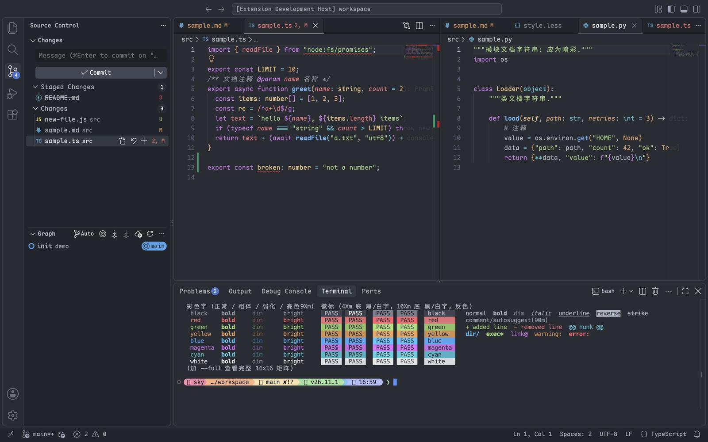

# Editor Comfort Theme

[English](../README.md) · **简体中文**

> 包页与市场页只显示英文版；扩展视图里的插件简介会随 VS Code 的显示语言显示中文。

16 套熟悉的 VS Code 深色与浅色主题，保留原主题配色，只修看不清的地方：One、Ayu、Sunlit（Solarized）、GitHub、Dracula、Owl（Night Owl）、Moka（One Monokai / Monokai）和 Pale（Palenight）。

喜欢某款流行主题，却总要眯眼看它的注释、偏淡的字符串或几乎看不见的终端选区？这套插件只改这些颜色，其余原样保留。自己在 `settings.json` 里改色只能一处一处地改；这里每套主题都按同一条对比度底线检查过，原主题没设、只能用 VS Code 通用默认色的界面色，也按主题自己的色板补齐了。

## 快速上手

1. 从 [VS Code 插件市场](https://marketplace.visualstudio.com/items?itemName=HeavenSky.editor-comfort-theme)安装，或按 `⌘P` / `Ctrl+P` 后执行 `ext install HeavenSky.editor-comfort-theme`。
2. 在命令面板（`⇧⌘P` / `Ctrl+Shift+P`）执行 **Preferences: Color Theme**（中文界面为「首选项：颜色主题」），或直接按 `⌘K ⌘T` / `Ctrl+K Ctrl+T`，选一套名为 `C <Name> Dark` 或 `C <Name> Light` 的主题，例如 `C One Dark`。编辑区、工作台和集成终端会立刻换成新配色。

## 还是你熟悉的那套主题

**底色、正文和语法色都和原主题一致。** 只有看不清的颜色才调整，且只调到够用，色相与饱和度不变。C GitHub Dark 和 GitHub Dark Dimmed 几乎一样；C Sunlit Light 则把 Solarized Light 注释的对比度从 2.5 提到 3.4。各套主题具体改了什么见[主题一览](docs/themes.md#找到你的原主题)。

## 每一行都不用眯眼看

正文、语法色和终端普通色与亮色的对比度不低于 4.5，注释不低于 3.4。编辑区、输入框和终端的选区都看得出，选中的字也读得清。侧栏、徽标和按钮上的字也提到够读，够读的标准按本主题正文的对比度推算。完整规则见[配色怎么调整](docs/how-themes-are-tuned.md)。

## 整个工作台都上了色

diff、git 标记、终端等界面色都和主题一致，不会退回 VS Code 的通用默认色：原主题没设的，取本主题自己的色相。原主题缺的语法规则只补在它没上色的 scope 上，不会覆盖原主题定义过的任何颜色。

## 终端也用同一套颜色

每套主题都配有同色板的 macOS Terminal.app 配置，双击 `.terminal` 文件即可[导入配置](docs/terminal-app.md)。

## 装上即用，无需配置

插件只有静态主题文件：没有设置项，不需要激活，也没有运行时代码。想关掉斜体或改某个颜色，用 VS Code 自带的设置即可，写法见[自定义主题](docs/customize.md)。

## 不适合的场景

想要更柔和、更暗或重新设计的观感，这些主题不合适：它们刻意保留原主题的亮度和饱和度。原主题本来就读得清的话，继续用原主题即可。

## 进一步阅读

- [文档](docs/README.md)：在其他编辑器里安装、全部主题与截图、Terminal.app 配置和自定义。
- [更新日志](../CHANGELOG.md)（英文）：每个版本改了什么。

## 许可证

[MIT](../LICENSE.txt)。基于若干 MIT 许可的主题，来源与配色出处见 [NOTICE.md](../NOTICE.md)。
