# 主题一览

[English](../../docs/themes.md) · **简体中文**

本页帮你从 16 套主题里挑一套，并写进 `settings.json`。前提是插件已经装好（见[快速上手](../README.md#快速上手)）。

## 找到你的原主题

每套主题保留一款原主题的配色，只修看不清的地方。最右列是改动内容；对比度指与编辑区底色之间的 WCAG 对比度。

| 主题 | 原主题 | 可读性修正 |
| --- | --- | --- |
| C One Dark | One Dark Pro 3.20.2 | 行号与焦点描边可读，终端选区看得出 |
| C One Light | Atom One Light 2.3.0 | 注释 2.5 → 3.4，偏淡的字符串、类型与常量提到 4.5 |
| C Ayu Dark | ayu Mirage | 侧栏与活动栏文字可读 |
| C Ayu Light | ayu Light | 注释 2.2 → 3.4，偏淡的字符串、数字与终端色提到 4.5；徽标与按钮上的字可读 |
| C Sunlit Dark | Solarized Dark | 注释 2.8 → 3.4，语法色从约 3.3 提到 4.5，终端选区看得出 |
| C Sunlit Light | Solarized Light | 正文 4.1 → 4.6，注释 2.5 → 3.4，语法色从约 3.0 提到 4.5，编辑区与终端选区看得出 |
| C GitHub Dark | GitHub Dark Dimmed 6.3.5 | 几乎不变：徽标字与查找高亮 |
| C GitHub Light | GitHub Light Default 6.3.5 | 几乎不变：三个偏淡的终端色 |
| C Dracula Dark | Dracula Soft 2.25.1 | 近纯白的正文 `#F6F6F4` 压到 `#D7D7D6`；徽标字与输入框选区 |
| C Dracula Light | Dracula 官方浅色色板 Alucard | 全新浅色设计：Dracula Soft 的结构换上 Alucard 色板，米色底 |
| C Owl Dark | Night Owl 2.1.1 | diff 新增色与查找高亮可读 |
| C Owl Light | Night Owl Light 2.1.1 | 注释 2.6 → 3.4，偏淡的正则、运算符与属性提到 4.5，终端色可读 |
| C Moka Dark | One Monokai 0.5.2 | 注释 2.8 → 3.4 |
| C Moka Light | 经典 Monokai 色板 | 全新浅色设计：以 Monokai 的正文色 `#F8F8F2` 作底，底色 `#272822` 作正文，彩色压深到浅底可读 |
| C Pale Dark | Palenight 2.0.5 | 注释 2.8 → 3.4，侧栏与状态栏文字可读 |
| C Pale Light | Palenight 2.0.5 色相 | 全新浅色设计：薰衣草色底，偏紫的深靛正文，Palenight 彩色压深，与 C Owl Light 明显区分 |

本来读得清的颜色原样保留。唯一有意的例外是深色主题里的近纯白，会稍微压低，见[配色怎么调整](how-themes-are-tuned.md#压低深色主题里的近纯白)。

## 在 settings.json 里指定主题

`settings.json` 里的主题 ID 与主题选择器里的名称相同。名称带 `C` 前缀，不与原主题重名，两者可以同时安装。

```jsonc
"workbench.colorTheme": "C One Dark"
```

想跟随操作系统的浅色或深色模式，各指定一套：

```jsonc
"window.autoDetectColorScheme": true,
"workbench.preferredDarkColorTheme": "C One Dark",
"workbench.preferredLightColorTheme": "C One Light"
```

## 看截图对比主题

每张图都截自真实的 VS Code 窗口：源代码管理、TypeScript、Python 与终端色板。图下方的链接还有两个场景：资源管理器配 Markdown、Less 与问题面板，以及搜索视图配输出面板。

| 深色 | 浅色 |
| --- | --- |
| C One Dark<br><br>[资源管理器与问题面板](../../media/screenshots/one-dark-a.jpg) · [搜索与输出面板](../../media/screenshots/one-dark-c.jpg) | C One Light<br>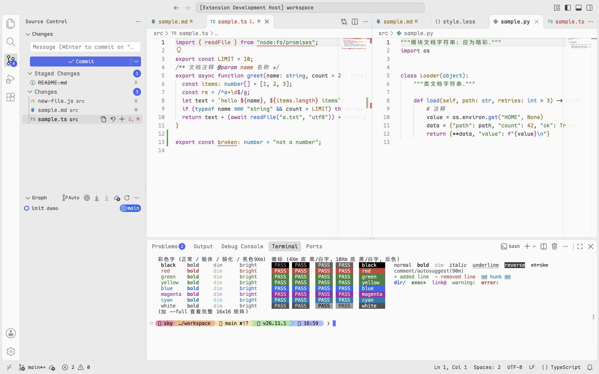<br>[资源管理器与问题面板](../../media/screenshots/one-light-a.jpg) · [搜索与输出面板](../../media/screenshots/one-light-c.jpg) |
| C Ayu Dark<br>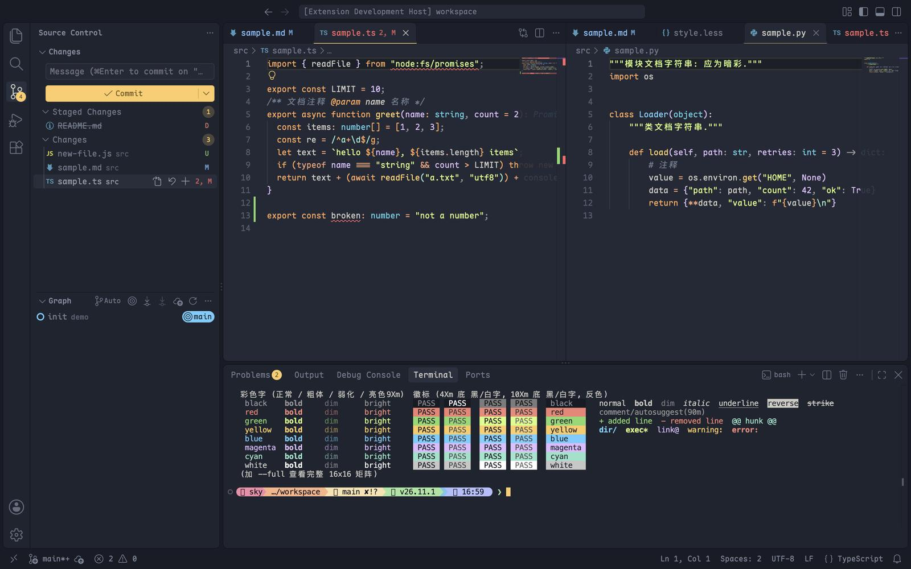<br>[资源管理器与问题面板](../../media/screenshots/ayu-dark-a.jpg) · [搜索与输出面板](../../media/screenshots/ayu-dark-c.jpg) | C Ayu Light<br>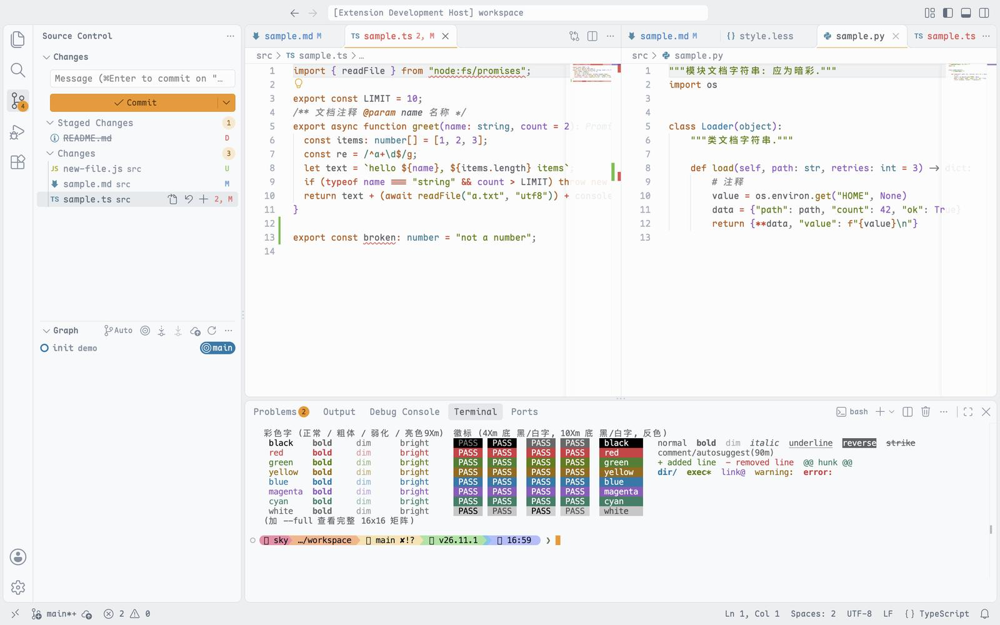<br>[资源管理器与问题面板](../../media/screenshots/ayu-light-a.jpg) · [搜索与输出面板](../../media/screenshots/ayu-light-c.jpg) |
| C Sunlit Dark<br>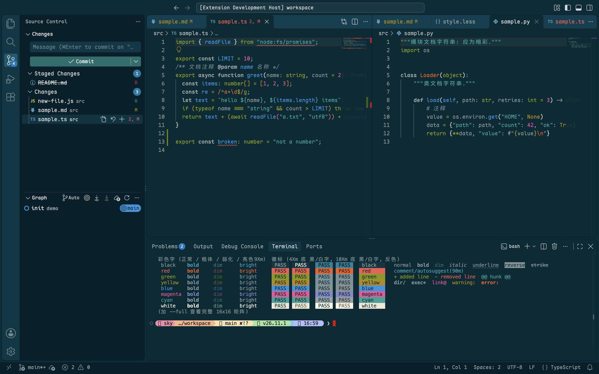<br>[资源管理器与问题面板](../../media/screenshots/sunlit-dark-a.jpg) · [搜索与输出面板](../../media/screenshots/sunlit-dark-c.jpg) | C Sunlit Light<br>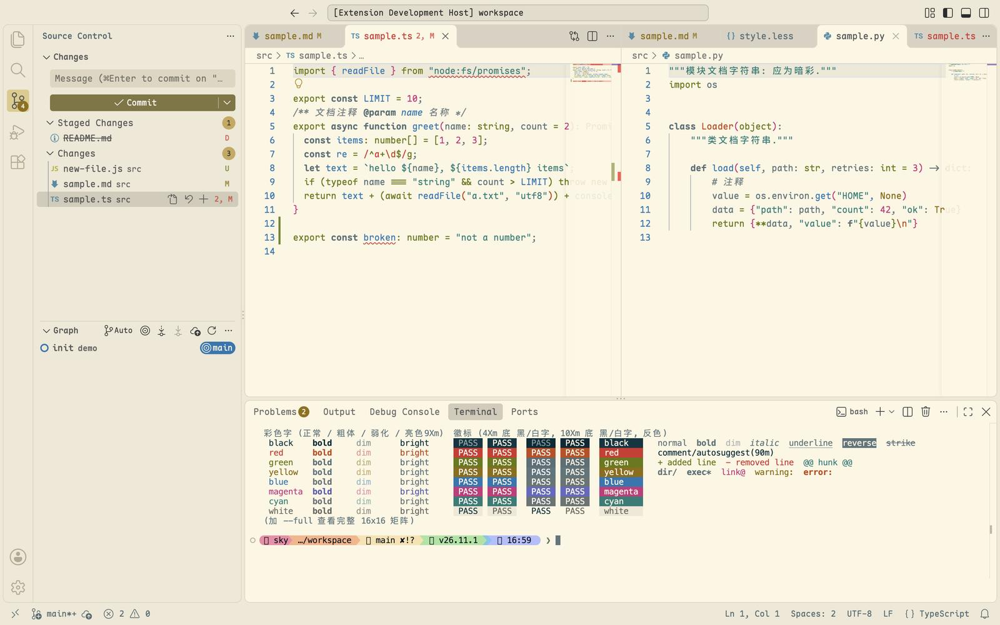<br>[资源管理器与问题面板](../../media/screenshots/sunlit-light-a.jpg) · [搜索与输出面板](../../media/screenshots/sunlit-light-c.jpg) |
| C GitHub Dark<br>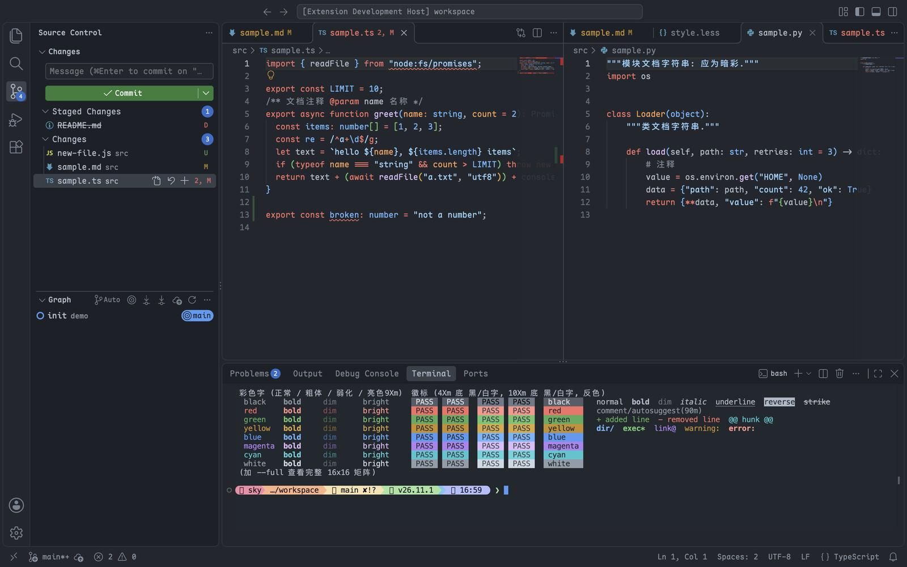<br>[资源管理器与问题面板](../../media/screenshots/github-dark-a.jpg) · [搜索与输出面板](../../media/screenshots/github-dark-c.jpg) | C GitHub Light<br>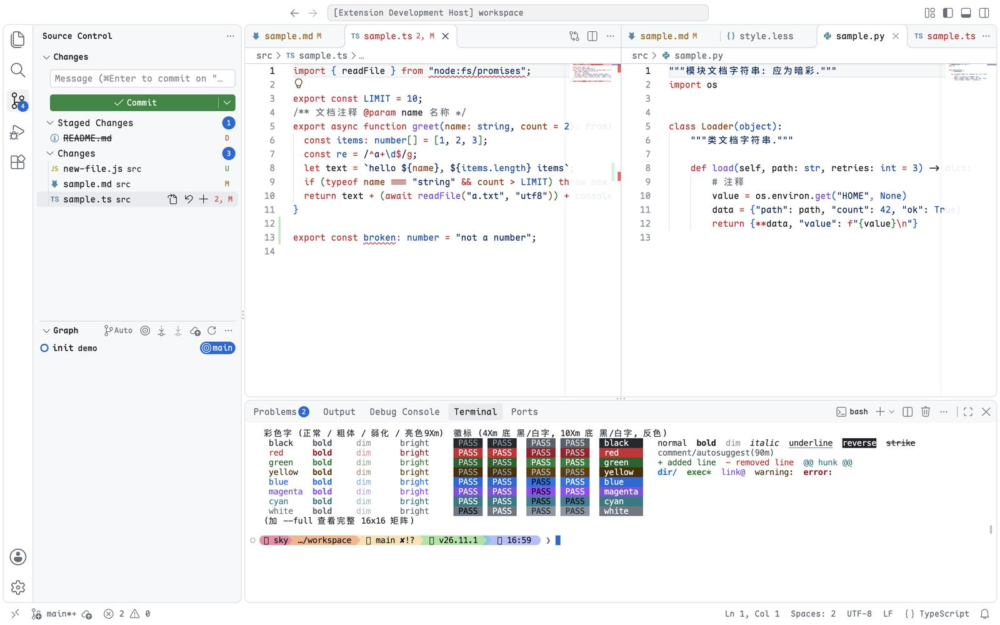<br>[资源管理器与问题面板](../../media/screenshots/github-light-a.jpg) · [搜索与输出面板](../../media/screenshots/github-light-c.jpg) |
| C Dracula Dark<br>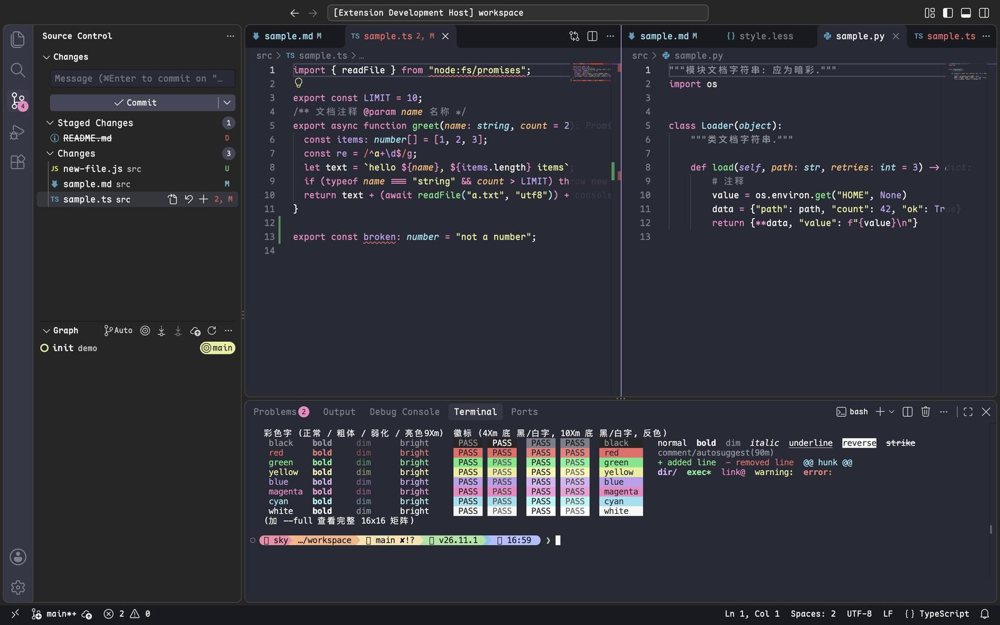<br>[资源管理器与问题面板](../../media/screenshots/dracula-dark-a.jpg) · [搜索与输出面板](../../media/screenshots/dracula-dark-c.jpg) | C Dracula Light<br>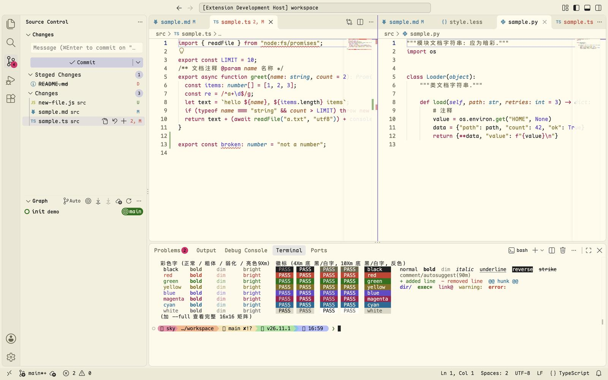<br>[资源管理器与问题面板](../../media/screenshots/dracula-light-a.jpg) · [搜索与输出面板](../../media/screenshots/dracula-light-c.jpg) |
| C Owl Dark<br>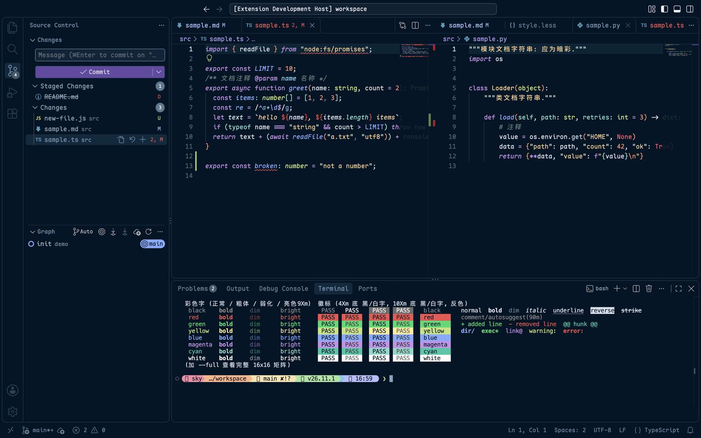<br>[资源管理器与问题面板](../../media/screenshots/owl-dark-a.jpg) · [搜索与输出面板](../../media/screenshots/owl-dark-c.jpg) | C Owl Light<br>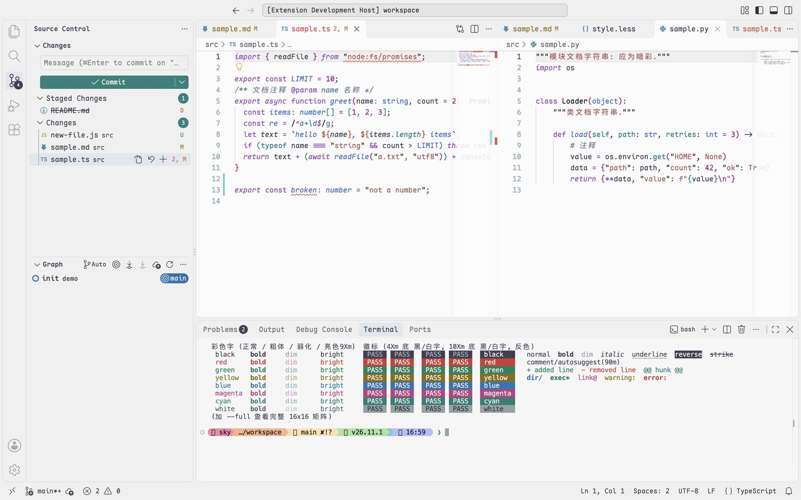<br>[资源管理器与问题面板](../../media/screenshots/owl-light-a.jpg) · [搜索与输出面板](../../media/screenshots/owl-light-c.jpg) |
| C Moka Dark<br>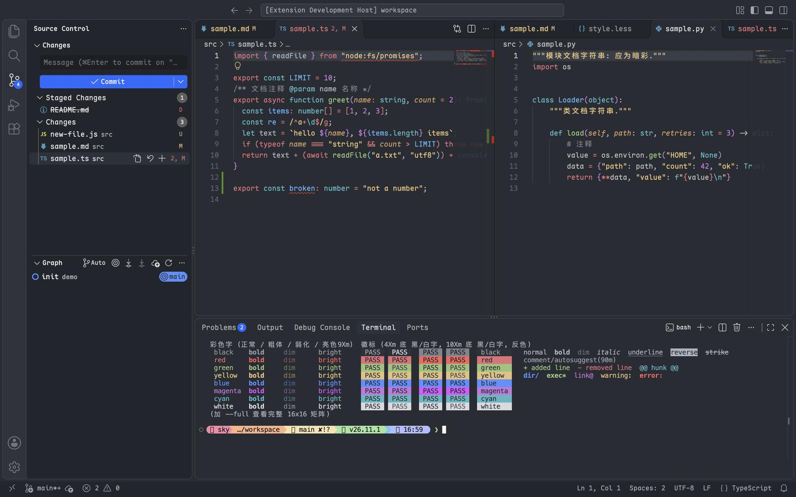<br>[资源管理器与问题面板](../../media/screenshots/moka-dark-a.jpg) · [搜索与输出面板](../../media/screenshots/moka-dark-c.jpg) | C Moka Light<br>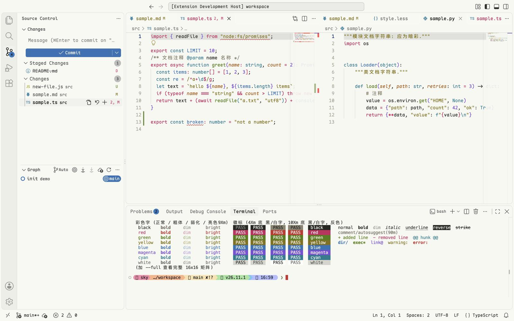<br>[资源管理器与问题面板](../../media/screenshots/moka-light-a.jpg) · [搜索与输出面板](../../media/screenshots/moka-light-c.jpg) |
| C Pale Dark<br>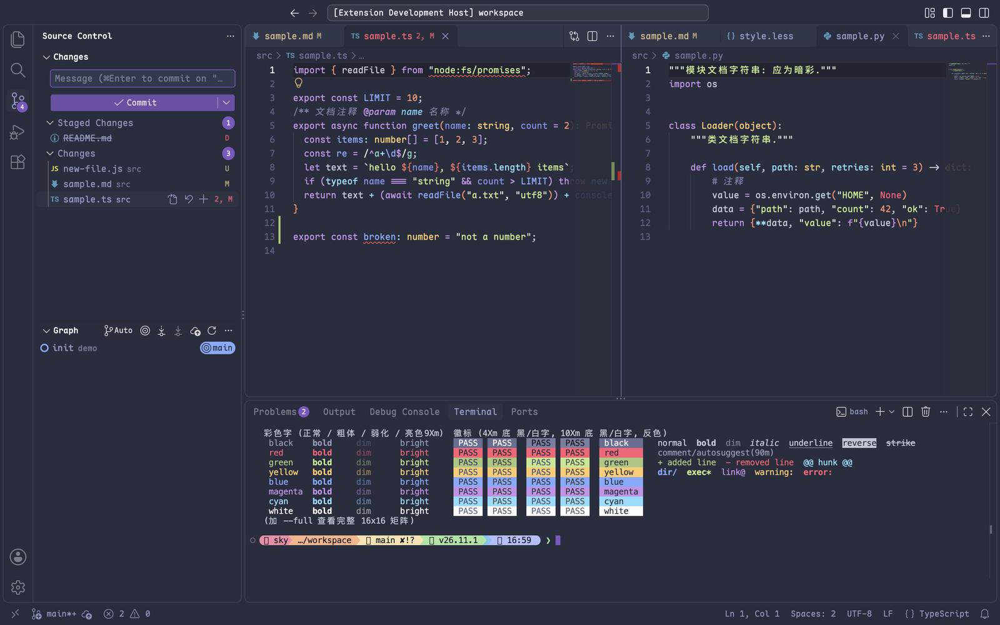<br>[资源管理器与问题面板](../../media/screenshots/pale-dark-a.jpg) · [搜索与输出面板](../../media/screenshots/pale-dark-c.jpg) | C Pale Light<br>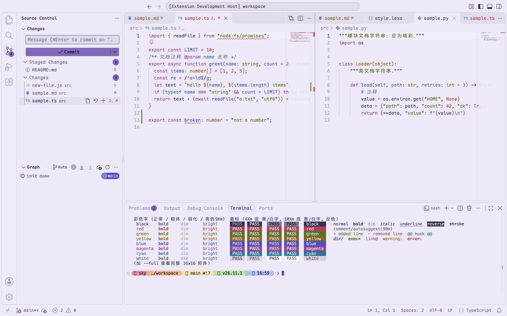<br>[资源管理器与问题面板](../../media/screenshots/pale-light-a.jpg) · [搜索与输出面板](../../media/screenshots/pale-light-c.jpg) |

## 更新后主题不见了

- 症状：更新后 VS Code 换回了默认主题，主题选择器里找不到 `Comfort <Name>` 主题。
- 原因：设置里还写着 v0.0.3 及更早版本的主题名，例如 `Comfort One Dark`；现在主题名是 `C <Name> Dark` 和 `C <Name> Light`。
- 解决：在 **Preferences: Color Theme**（「首选项：颜色主题」）里重新选择，或把 `workbench.colorTheme`、`workbench.preferredDarkColorTheme` 和 `workbench.preferredLightColorTheme` 里的旧名称换成新名称。
